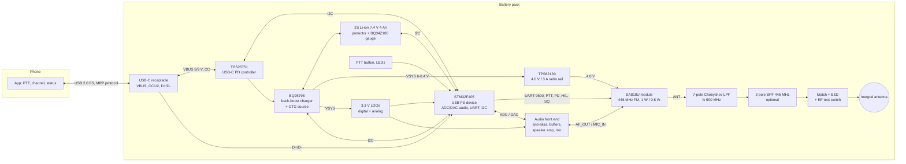

# 2. System architecture

## 2.1 Block diagram

## 2.2 Design decisions

| Decision | Choice | Why | Rejected alternatives |
|----------|--------|-----|-----------------------|
| Radio | SA818U-V4 / DRA818U module | Certified-grade 446 MHz FM transceiver with PA, T/R switch, audio processing, CTCSS/DCS, UART control, 1 W, cheap and shielded. | Discrete RDA1846S + PA (more work, same chip); SA868 2 W (power not usable, hotter); SX1262 (data only, no PMR446 voice). |
| Antenna | Integral stubby helical (v1), PCB IFA option | Vertical, predictable, least affected by the phone body. | Internal-only IFA first (risky when stacked on a metal phone), see docs/05. |
| Filters | External 7-pole LPF in common path; BPF optional | Module harmonics alone are marginal against -36 dBm; LPF also protects the receiver from the phone's 700-900 MHz uplink. | Elliptic LPF (sharper but less tolerant); SAW in common path (cannot take 1 W). |
| MCU | STM32F405RGT6 | USB FS device, two 12-bit DACs and fast ADCs for audio without a codec, plenty of timers/DMA, TinyUSB support. | RP2040 (no DAC), ESP32-S3 (adds a 2.4 GHz radio and noise next to a -120 dBm receiver). |
| Phone link | Vendor bulk interface + MRP, UAC optional | Avoids Android global audio re-routing, one protocol for everything, works on Linux/Windows for bench. | UAC + HID (Android hijacks audio; iOS has no vendor access anyway); BLE (another radio, latency, pairing). |
| PD controller | TPS25751D with BQ25798 | TI reference pairing for DRP power banks, handles swaps and protections, I2C to MCU. | FUSB302B + software PD stack on the MCU (more flexible, much more firmware; kept as alternative). |
| Battery | 2S1P 4 Ah Li-ion pouch | 9/12 V source with buck-boost efficiency, thin, 29.6 Wh. | 1S (boost from 3.7 V to 9 V at 2 A is lossy, hot); 2S2P 18650 (too thick for a phone-back pack). |
| Audio | MCU ADC/DAC, 16 kHz | Half-duplex voice band; no codec IC; simple. | I2S codec (more parts, needed only for hi-fi). |

## 2.3 Power budget

Battery 2S, 7.4 V nominal, 4.0 Ah = 29.6 Wh; usable ~27 Wh.

| Mode | Consumers | Power | Endurance (radio only) |
|------|-----------|-------|------------------------|
| Standby, radio RX, USB idle | module 65 mA @ 4.0 V (0.26 W), buck/LDO/MCU ~0.15 W, gauge/PD ~0.02 W | ~0.45 W | ~60 h |
| RX with audio to phone | + ADC/DMA/USB ~0.1 W | ~0.55 W | ~49 h |
| TX 1 W RF (module ~750 mA @ 4.0 V) | 3.0 W + 0.3 W | ~3.3 W | 10 % duty average ~0.8 W -> ~34 h |
| Sourcing 18 W to phone | 18 W out, ~94 % buck-boost | ~19.2 W from battery | ~1.4 h, delivers ~25 Wh |
| Charging the pack at 27 W input | 2 A into cells | - | 0-80 % in ~1.7 h |

Radio keeps priority: sourcing stops at 20 % state of charge, leaving about
5.5 Wh, i.e. roughly 7 h of RX/TX use (docs/03).

## 2.4 Interfaces inside the pack

| From | To | Signal |
|------|----|--------|
| MCU USART1 | SA818 RXD/TXD | 9600 8N1 AT commands, 3.3 V logic |
| MCU GPIO | SA818 PTT (active low), PD (power down, low = sleep), H/L (power level) | open-drain or push-pull 3.3 V |
| SA818 SQ | MCU GPIO (EXTI) | squelch status, low when carrier present (VERIFY polarity on the module revision) |
| SA818 AF_OUT | anti-alias filter -> MCU ADC1 | 0-3.3 V audio, DC biased |
| MCU DAC1 | attenuator / RC -> SA818 MIC_IN | 10-100 mVpp into the module mic input (VERIFY level) |
| MCU I2C1 | TPS25751, BQ25798, BQ34Z100-G1 | 400 kHz, with interrupt lines from PD and charger |
| MCU USB FS | USB-C D+/D- (both pairs tied) | 12 Mbit/s |
| MCU GPIO | PTT button, 2 LEDs, speaker amp enable, mic enable | - |
| MCU ADC | PA thermistor, antenna-switch sense (test port inserted) | - |
