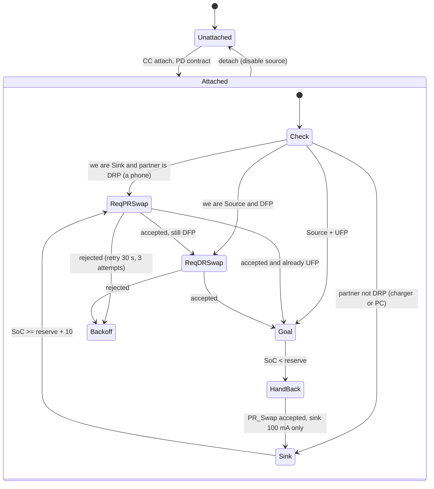

# 3. Power and USB-C Power Delivery

## 3.1 Battery

- 2S1P Li-ion pouch, 2 x 4000 mAh, 7.4 V nominal, 8.4 V max, 6.0 V cut-off,
  29.6 Wh. Cells with a 0.5 C (2 A) charge rating and 2 C discharge (8 A),
  e.g. 606090-class pouch cells 70 x 60 x 6 mm.
- **Primary protection**: 2S protector IC (Seiko S-8252 class or equivalent)
  driving dual N-channel FETs in the low side: OV 4.25 V/cell, UV 2.8 V/cell,
  OC discharge 8 A, short-circuit, with cell balancing provided by the
  charger (BQ25798 has none; use a 2S balancer front end such as BQ29209 or
  the gauge's balancing if a BQ40Z50 class gauge is chosen).
- **Secondary protection**: BQ7718 over-voltage protector blowing a 2S
  chemical fuse (Dexerials SFJ class) at 4.35 V/cell.
- **Fuel gauge**: BQ34Z100-G1 (Impedance Track, multi-cell, I2C), 5 mOhm sense
  resistor, NTC on the cells. Alternative: estimate from BQ25798 ADC + coulomb
  counting in firmware (cheaper, +/-10 %).
- NTC thresholds: charge only between 0 and 45 C, discharge -20 to 60 C, TX
  inhibit above 60 C cell temperature.

## 3.2 Charger and power path: BQ25798

Buck-boost charger, 1-4S, input 3.6-24 V, 5 A charge, integrated OTG output
2.8-22 V up to 3.3 A (datasheet values; **VERIFY** OTG current at 9 V on the
chosen revision, the 18 W source PDO assumes 2 A at 9 V).

- Battery side: 2S, charge voltage 8.4 V, charge current 2.0 A, termination
  200 mA, pre-charge 300 mA, safety timer 8 h.
- VSYS: tracks the battery (6.0-8.4 V) with 6.2 V minimum system voltage, so
  the radio keeps running from VBUS even with an empty battery (P6).
- Input current limit set from the PD contract by the MCU (ILIM_HIZ pin tied
  to TPS25751 is also possible, but register control is simpler to debug).
- OTG mode: the MCU writes the OTG voltage (5.0/9.0/12.0 V) and current
  limit when the PD controller reports a source contract.
- Inductor 2.2 uH / 8 A saturation, shielded; input and output 4 x 22 uF
  25 V X7R. Switching frequency 750 kHz with dithering **off** during
  reception if spur tests show problems (1.5 MHz option moves harmonics;
  the 446 MHz receiver is 595th harmonic away, well below any realistic
  harmonic amplitude, but the layout must keep the switch node tiny).

## 3.3 Rails

| Rail | Source | Load | Notes |
|------|--------|------|-------|
| VSYS 6.0-8.4 V | BQ25798 | buck, LDOs, speaker amp | main bus |
| +4V0 / 3 A | TPS62130 (adjustable sync buck, 2.5 MHz, forced PWM) | SA818 VCC | LC post filter 1 uH + 22 uF, then 100 uF low-ESR at the module; ripple < 10 mVpp. Forced PWM keeps the frequency fixed and out of the audio band in RX. |
| +3V3D / 300 mA | TPS7A20 from +4V0 | MCU, PD, gauge logic, LEDs | low-noise LDO from the 4 V rail (0.7 V drop, 0.2 W worst case) |
| +3V3A / 150 mA | LP5907 from +4V0 | op-amps, mic bias, ADC/DAC reference | separate star ground return to the ADC ground |
| VBUS | BQ25798 OTG or external | USB-C | 5-20 V |

TX current step: the module pulls ~0.8 A within ~1 ms when keyed. With the
TPS62130 (3 A) the +4V0 rail dips < 100 mV with 100 uF local bulk; measured in
test T-P4 (docs/11).

## 3.4 USB-C and PD roles: why swaps are needed

Type-C by itself ties the roles together: whoever supplies VBUS is also the
USB host (DFP). The pack wants the opposite pairing:

| | Power | Data |
|-|-------|------|
| Phone | Sink (gets charged) | Host / DFP (runs the app) |
| Pack | **Source** | **Device / UFP** |

USB PD allows it: after the initial Type-C attach, the roles can be changed
independently with `PR_Swap` (power) and `DR_Swap` (data). The pack's policy,
implemented in `firmware/src/pd_policy.c` and tested in
`firmware/tests/test_pd_policy.c`:

Practical notes:

- Configure the TPS25751 as DRP with **Try.SRC**. Phones implement Try.SNK, so
  the pack usually wins as Source/DFP, then only a `DR_Swap` is needed; that
  is the same sequence a USB-C monitor with power delivery uses with a
  laptop, and phones accept it.
- If the phone ends up Source/DFP (some phones with a full battery refuse
  Try.SRC), the pack asks for `PR_Swap`. Android accepts it when the pack
  advertises a usable Source PDO (5 V/3 A, 9 V/2 A).
- While we are the sink of a DRP partner we draw only 100 mA (trickle for
  the logic), so a phone is never drained by the pack unless the user allows
  it (`SET_POWER` flag `charge`).
- No PD (5 V legacy host, A-to-C cable): the pack is a plain USB device
  powered by the phone's OTG 5 V; the radio still works (phone drains ~0.5 W).
  Power sharing is not possible without PD, the app shows this.
- Wall charger (not DRP): sink at the full negotiated power, no swaps.
- Source PDOs advertised: 5 V/3 A, 9 V/2 A (and 12 V/1.5 A when the measured
  OTG current allows). Sink PDOs: 5 V/3 A, 9 V/3 A, 15 V/2 A.
- The data lines are 12 Mbit/s full speed only: no SuperSpeed mux, D+/D- of
  both connector orientations are simply tied together.
- VCONN is not needed (no e-marker required under 3 A / 60 W). The TPS25751
  still supplies VCONN if a cable asks.

## 3.5 Protections

- VBUS: TPS25751 integrated sink path and external source path FETs with
  OVP (23 V), reverse-current blocking, 5 A short-circuit, discharge resistor.
- CC pins: 24 V tolerant (CC short to VBUS test), ESD 8 kV.
- D+/D-: TVS array (0.5 pF) at the connector, common-mode choke 90 ohm
  @ 100 MHz, then 22 ohm series resistors at the MCU.
- Thermal: NTC on PA area and charger; firmware throttles source current at
  60 C board temperature, inhibits TX at 70 C PA temperature.
- Radio rail enable is sequenced after +3V3D so that the module never sees
  floating UART/PTT lines (PTT floating can key the transmitter).
