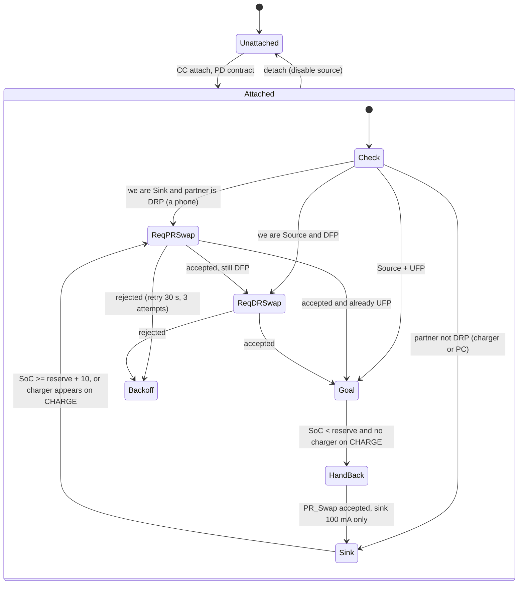

# 3. Power and USB-C Power Delivery

Two USB-C ports on the bottom edge:

| Port | Label | Roles | Controller | Purpose |
|------|-------|-------|------------|---------|
| J1 | **PHONE** | power DRP (normally source), data device (UFP), USB 2.0 | TPS25751 + TPS55288 source converter | short cable to the phone: charges it and carries the radio link; also accepts a charger or a PC |
| J3 | **CHARGE** | power sink only, no data | STUSB4500 | wall charger in, up to 45 W; charges the pack while the PHONE port keeps charging the phone (pass-through) |

## 3.1 Battery

- 2S1P Li-ion pouch, 2 x 4000 mAh, 7.4 V nominal, 8.4 V max, 6.0 V cut-off,
  29.6 Wh. Cells with a 0.5 C (2 A) charge rating and 2 C discharge (8 A),
  e.g. 606090-class pouch cells 70 x 60 x 6 mm.
- **Primary protection**: 2S protector IC (Seiko S-8252 class or equivalent)
  driving dual N-channel FETs in the low side: OV 4.25 V/cell, UV 2.8 V/cell,
  OC discharge 8 A, short-circuit; cell balancing by a BQ29209 2S balancer
  (the BQ25798 has none).
- **Secondary protection**: BQ7718 over-voltage protector blowing a 2S
  chemical fuse (Dexerials SFJ class) at 4.35 V/cell.
- **Fuel gauge**: BQ34Z100-G1 (Impedance Track, multi-cell, I2C), 5 mOhm sense
  resistor, NTC on the cells.
- NTC thresholds: charge only between 0 and 45 C, discharge -20 to 60 C, TX
  inhibit above 60 C cell temperature.

## 3.2 Power architecture: charging in and out at the same time

```
PHONE port VBUS  --ACFET1--> VAC1 \                       /--> VSYS --> TPS62130 4.2 V --> radio
                                   BQ25798 (sink only) --+--> VSYS --> LDOs 3.3 V --> MCU, audio, PD
CHARGE port VBUS --ACFET2--> VAC2 /         |              \--> VSYS --> TPS55288 buck-boost --> PHONE port VBUS (source)
                                         battery 2S
```

- The BQ25798 only ever **sinks**. Its two input paths (VAC1 = PHONE, VAC2 =
  CHARGE, each through back-to-back FETs driven by the charger) let it take
  power from whichever port has a supply; CHARGE has priority when both do.
- Sourcing to the phone is done by a **separate** TPS55288 buck-boost
  (VSYS 6-8.4 V in, 5/9/12 V out, 36 W class, I2C set-point and current
  limit), switched onto the PHONE port VBUS by the TPS25751's source-path FETs.
  Because sourcing never uses the charger's VBUS pin, charging the battery
  from CHARGE and charging the phone from PHONE happen simultaneously.
- Pass-through power flow: the charger's input current limit is set from the
  CHARGE PD contract; the BQ25798's dynamic power management supplies VSYS
  first (radio, logic, the TPS55288 feeding the phone) and gives the battery
  what is left. Phone priority is therefore automatic.
- Feedback guard: while the TPS55288 drives the PHONE port, ACFET1 is held
  off so the pack cannot "charge itself" from its own output.

## 3.3 Charger: BQ25798

Buck-boost charger, 1-4S, input 3.6-24 V, 5 A charge, dual input selection
(VAC1/VAC2 with external ACFET/RBFET pairs). OTG mode is not used.

- Battery side: 2S, charge voltage 8.4 V, charge current 2.0 A (throttled
  by firmware to 60 % above 50 C and 25 % above 60 C board temperature),
  termination 200 mA, pre-charge 300 mA, safety timer 8 h.
- VSYS: tracks the battery (6.0-8.4 V) with 6.2 V minimum system voltage, so
  the radio keeps running from an input even with an empty battery (P6).
- Input current limit per active input, written by the MCU from the
  respective PD contract (CHARGE: STUSB4500 report; PHONE: TPS25751 report).
- Inductor 2.2 uH / 8 A saturation, shielded; input and output 4 x 22 uF
  25 V X7R; 750 kHz switching, spread spectrum off during reception if spur
  tests show problems.

## 3.4 PHONE port source converter: TPS55288

- Input VSYS, output 5.0 / 9.0 / 12.0 V programmed over I2C to match the
  source PDO the phone requested; output current limit 3.0 / 2.0 / 1.5 A.
- Enabled only after the TPS25751 reports a source contract (or a legacy sink
  attached and the policy allows sourcing); disabled on detach, on
  hand-back, and on over-temperature.
- Efficiency ~94 % at 9 V / 2 A; ~1.1 W dissipation at 18 W out.
- Source PDOs advertised on PHONE: 5 V/3 A, 9 V/2 A, 12 V/1.5 A (18 W class).

## 3.5 CHARGE port: STUSB4500

Autonomous sink controller with NVM-stored PDO preferences: it negotiates
the highest of 20 V/2.25 A, 15 V/3 A, 9 V/3 A, 5 V/3 A that the charger
offers (max 45 W), with no firmware needed for the negotiation. The MCU
reads the contract over I2C to set the BQ25798 input limit and to report it
in `STATUS` (`in_mv`, `in_ma`). CC pins only; D+/D- are not connected (no
data, no BC1.2: a legacy 5 V source is used at 1.5 A by Type-C current
advertisement).

## 3.6 Rails

| Rail | Source | Load | Notes |
|------|--------|------|-------|
| VSYS 6.0-8.4 V | BQ25798 | TPS55288, buck, LDOs, speaker amp | main bus |
| +4V2 / 3 A | TPS62130 (adjustable sync buck, 2.5 MHz, forced PWM) | SA818S-CE VCC | the module is specified at 4.2 V typical (3.3-5.5 V range). LC post filter 1 uH + 22 uF, then 100 uF low-ESR at the module; ripple < 10 mVpp. |
| +3V3D / 300 mA | TPS7A20 from +4V2 | MCU, PD controllers, gauge logic, LEDs | low-noise LDO |
| +3V3A / 150 mA | LP5907 from +4V2 | op-amps, mic bias, ADC/DAC reference | separate star ground |
| VBUS PHONE | TPS55288 (source) or external | PHONE port | 5-12 V out, 5-20 V in |
| VBUS CHARGE | external only | CHARGE port | 5-20 V in |

TX current step: the module pulls ~0.8 A within ~1 ms when keyed. With the
TPS62130 (3 A) the +4V2 rail dips < 100 mV with 100 uF local bulk; measured in
test T-P4 (docs/11).

## 3.7 PHONE port PD roles: why swaps are needed

Type-C by itself ties the roles together: whoever supplies VBUS is also the
USB host (DFP). The pack wants the opposite pairing on the PHONE port:

| | Power | Data |
|-|-------|------|
| Phone | Sink (gets charged) | Host / DFP (runs the app) |
| Pack | **Source** | **Device / UFP** |

USB PD allows it: after the initial Type-C attach, the roles can be changed
independently with `PR_Swap` (power) and `DR_Swap` (data). The pack's policy,
implemented in `firmware/src/pd_policy.c` and tested in
`firmware/tests/test_pd_policy.c`:



Practical notes:

- Configure the TPS25751 as DRP with **Try.SRC**. Phones implement Try.SNK, so
  the pack usually wins as Source/DFP, then only a `DR_Swap` is needed; that
  is the same sequence a USB-C monitor with power delivery uses with a
  laptop, and phones accept it.
- If the phone ends up Source/DFP (some phones with a full battery refuse
  Try.SRC), the pack asks for `PR_Swap`. Android accepts it when the pack
  advertises a usable Source PDO.
- While we are the sink of a DRP partner we draw only 100 mA (trickle for
  the logic), so a phone is never drained by the pack unless the user allows
  it (`SET_POWER` flag `charge`).
- **Pass-through rule**: a charger on CHARGE sets `external_power` in the
  policy; the reserve (20 %) no longer stops sourcing, and a hand-back in
  progress is reversed. Removing the charger at low SoC triggers the normal
  hand-back.
- No PD (5 V legacy host, A-to-C cable on PHONE): the pack is a plain USB
  device powered by the phone's 5 V; the radio works, no power sharing.
- Source PDOs: 5 V/3 A, 9 V/2 A, 12 V/1.5 A. Sink PDOs on PHONE: 5 V/3 A,
  9 V/3 A, 15 V/2 A (a charger plugged into PHONE by mistake simply charges
  the pack, through VAC1).
- Data lines are 12 Mbit/s full speed only, D+/D- of both orientations tied;
  no VCONN needed (TPS25751 supplies it if a cable asks).

## 3.8 What happens with each plug combination

| PHONE port | CHARGE port | Behaviour |
|------------|-------------|-----------|
| phone (PD) | nothing | pack sources up to 18 W until 20 % SoC, then hands back and trickles; app works throughout |
| phone (PD) | 45 W charger | **pass-through**: phone gets its 18 W first, battery charges with the rest, radio and link unaffected, reserve ignored |
| phone (PD) | 5 V / 1.5 A legacy supply | phone still gets 18 W; net battery drain ~11 W slower than without; flagged as pass-through |
| phone, legacy 5 V (no PD) | charger | phone powers the link at 5 V; pack charges from CHARGE; no power to the phone |
| charger | nothing | pack charges through VAC1; no data, no sourcing (P12) |
| charger | charger | BQ25798 selects CHARGE; PHONE input idle; nothing is damaged |
| PC (host) | nothing or charger | pack is a USB device for the PC (app or sound-card profile); draws 100 mA from the PC, charges from CHARGE if present |
| nothing | charger | plain charging, radio usable standalone |
| phone that enables reverse charging | any | policy accepts the swap only when we no longer want to source (docs/03.7) |

## 3.9 Protections

- Both ports: TPS25751 / STUSB4500 VBUS OVP (23 V), ESD 8 kV on CC and VBUS,
  24 V tolerant CC (short to VBUS test); PHONE source path FETs with
  reverse-current blocking, 5 A short-circuit, discharge resistor.
- ACFET pairs on VAC1/VAC2 block reverse current between the two ports and
  from the battery to a dead charger.
- D+/D- (PHONE only): TVS array (0.5 pF), common-mode choke, 22 ohm series.
- Thermal: NTC on PA area and charger; firmware throttles battery charge at
  50/60 C board temperature, then the TPS55288 output power (phone), and
  inhibits TX at 70 C PA temperature. Pass-through at 45 W in / 18 W out is
  the warmest continuous case (docs/09).
- Radio rail enable is sequenced after +3V3D so that the module never sees
  floating UART/PTT lines.
